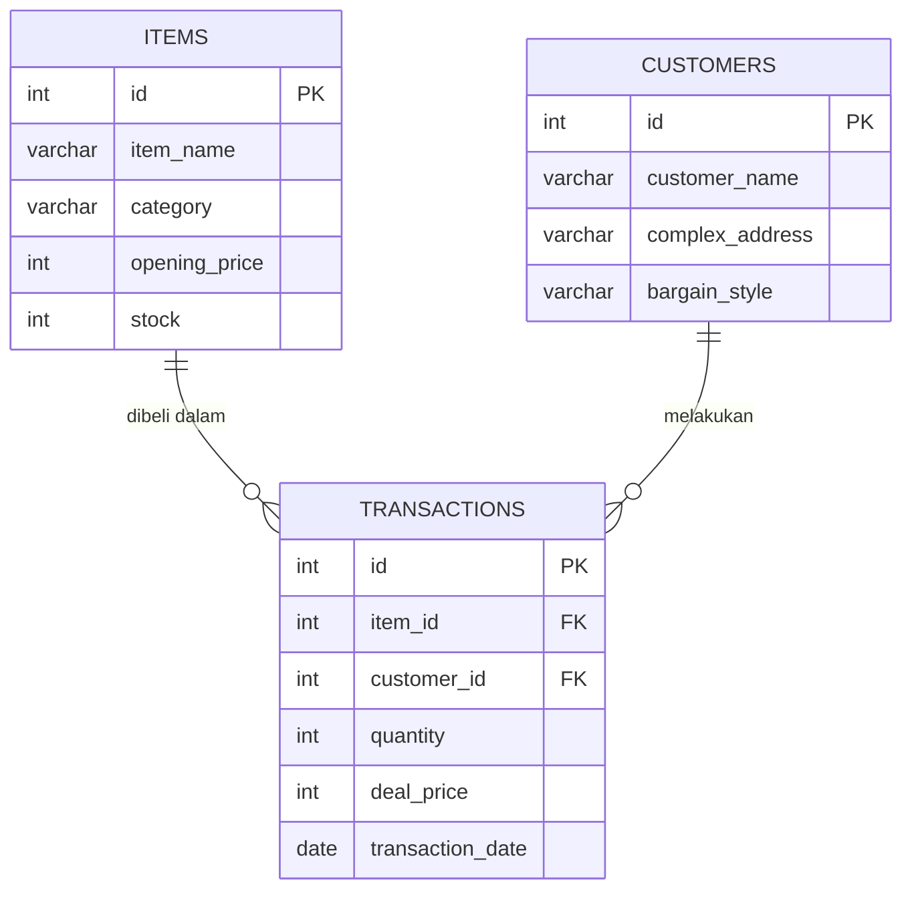
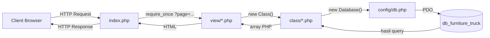
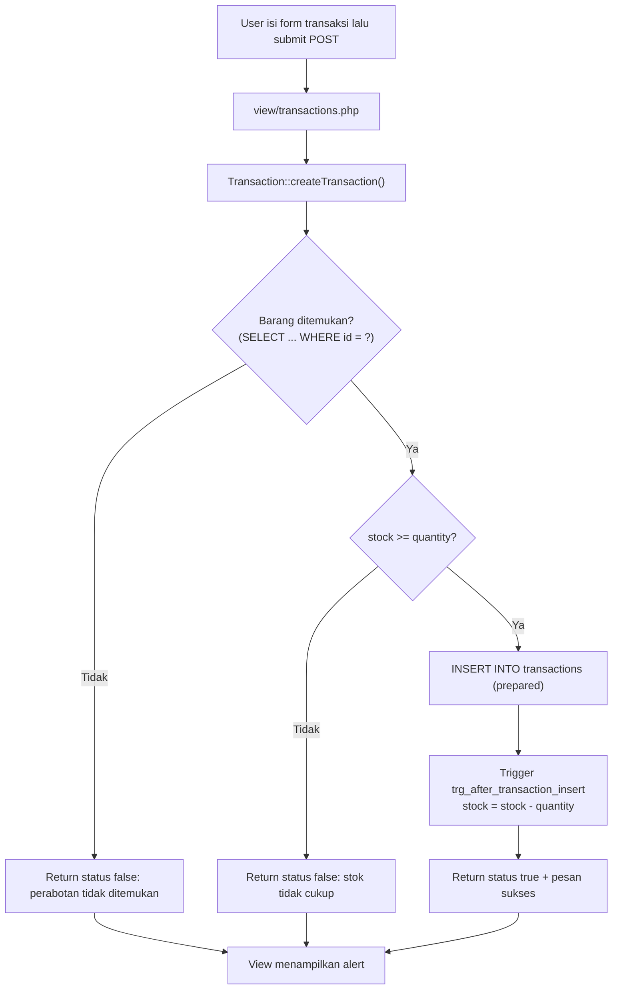
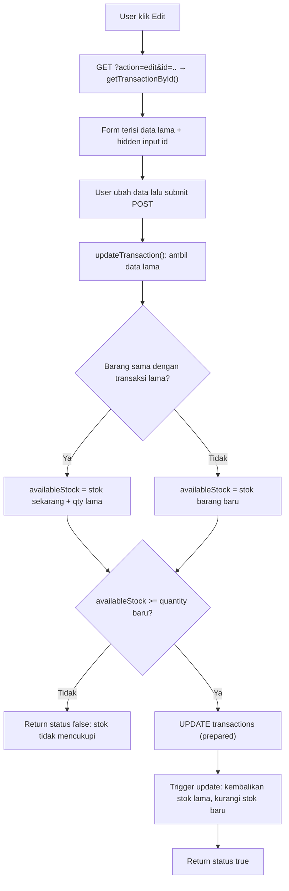
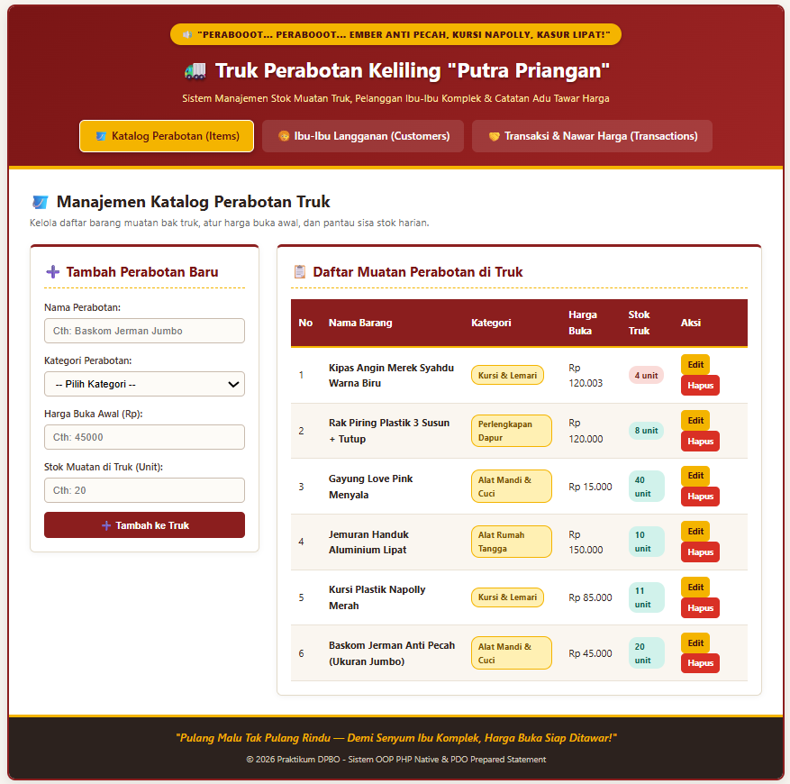
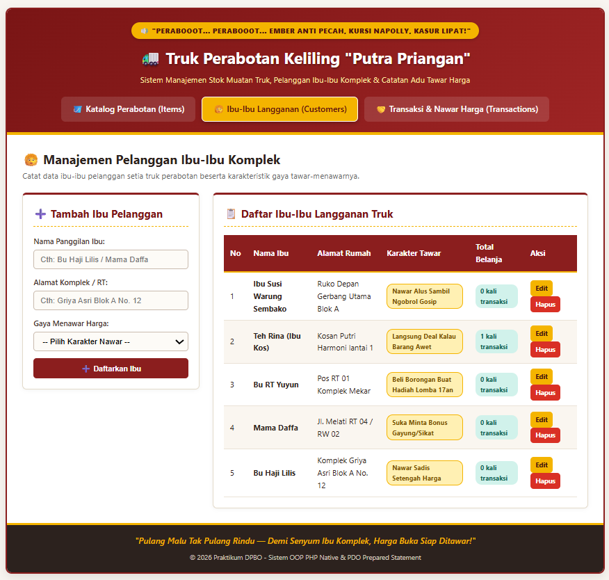
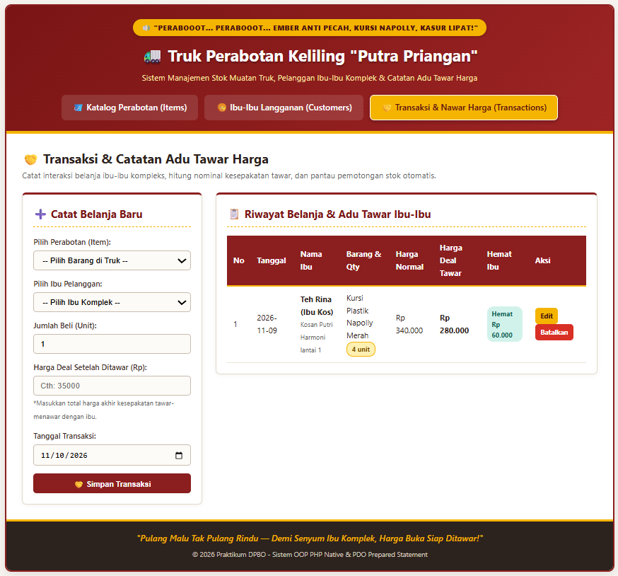

# TP7DPBO2526C2 — Sistem Truk Perabotan Keliling "Putra Priangan"

> Tugas Praktikum 7 — Desain dan Pemrograman Berorientasi Objek (DPBO)
> Web berbasis **PHP Native** dengan konsep **OOP**, **PDO Prepared Statement**, dan **GUI**.

### Janji

Saya `Moch Fadillah Pratama` dengan NIM `2506968` mengerjakan Tugas Praktikum 7 dalam mata kuliah Desain dan Pemrograman Berorientasi Objek untuk keberkahanNya maka saya tidak melakukan kecurangan seperti yang telah dispesifikasikan. Aamiin.

---

## 1. Tema Website

Aplikasi ini adalah **sistem manajemen penjualan truk perabotan keliling** yang biasa lewat di komplek perumahan. Abang penjual membawa berbagai perabotan di bak truk (ember, kursi plastik, jemuran, sapu, dll.), lalu ibu-ibu komplek menawar harga sebelum sepakat membeli.

Sistem ini membantu mencatat:

- **Muatan truk** beserta harga buka dan sisa stok (`items`),
- **Ibu-ibu pelanggan** beserta alamat dan gaya tawar-menawarnya (`customers`),
- **Transaksi** belanja beserta harga deal setelah ditawar (`transactions`).

Dari transaksi, sistem otomatis menghitung **harga normal**, **harga deal**, dan **jumlah hemat** hasil tawar-menawar, serta **mengurangi/mengembalikan stok** secara otomatis.

---

## 2. Fitur Utama

| Entitas | Create | Read | Update | Delete | Catatan |
|---|:-:|:-:|:-:|:-:|---|
| **Items** (Perabotan) | ✅ | ✅ | ✅ | ✅ | Hapus ditolak jika barang sudah pernah dibeli (`ON DELETE RESTRICT`) |
| **Customers** (Pelanggan) | ✅ | ✅ | ✅ | ✅ | Menampilkan total transaksi tiap pelanggan (`LEFT JOIN`). Hapus pelanggan ikut menghapus transaksinya (`ON DELETE CASCADE`) |
| **Transactions** (Transaksi) | ✅ | ✅ | ✅ | ✅ | Validasi stok, `JOIN` 3 tabel, hitung selisih hemat, stok otomatis via **Trigger** |

Fitur tambahan:

- Validasi stok sebelum transaksi disimpan (create & update).
- Notifikasi sukses/gagal (alert) pada setiap aksi.
- Output di-escape dengan `htmlspecialchars()` untuk mencegah XSS.
- Konfirmasi JavaScript sebelum menghapus data.

---

## 3. Teknologi

- **PHP Native** (tanpa framework), paradigma OOP
- **MySQL / MariaDB** (InnoDB, Foreign Key, Trigger)
- **PDO** dengan *native prepared statement* (`ATTR_EMULATE_PREPARES = false`)
- **HTML + CSS** untuk antarmuka
- Server lokal: **Laragon** / **XAMPP**

---

## 4. Struktur Folder

```
TP7DPBO2526C2/
├── class/
│   ├── Item.php            # Model OOP tabel items
│   ├── Customer.php        # Model OOP tabel customers
│   └── Transaction.php     # Model OOP tabel transactions
├── config/
│   └── db.php              # Class Database (koneksi PDO)
├── database/
│   └── db_furniture_truck.sql   # Struktur, trigger, dan data awal
├── view/
│   ├── header.php          # Header + navbar (modular)
│   ├── footer.php          # Footer (modular)
│   ├── items.php           # Halaman CRUD Items
│   ├── customers.php       # Halaman CRUD Customers
│   └── transactions.php   # Halaman CRUD Transactions
├── index.php               # Entry point & router halaman
├── style.css               # Styling
└── README.md
```

| Folder / File | Fungsi |
|---|---|
| `class/` | Satu class per tabel; berisi seluruh method CRUD ke database |
| `config/` | Konfigurasi dan koneksi database |
| `database/` | File `.sql` (struktur + trigger + data contoh) |
| `view/` | Elemen HTML modular dan halaman per entitas |
| `index.php` | Titik awal aplikasi, memilih view berdasarkan parameter `?page=` |
| `style.css` | Tampilan halaman |

---

## 5. Penjelasan Database

**Nama database:** `db_furniture_truck` — terdiri dari **3 tabel** dengan **2 relasi foreign key**.

### 5.1 ERD



### 5.2 Tabel `items` — data perabotan di truk

| Kolom | Tipe | Keterangan |
|---|---|---|
| `id` | INT, PK, AUTO_INCREMENT | ID barang |
| `item_name` | VARCHAR(100), NOT NULL | Nama perabotan |
| `category` | VARCHAR(50), NOT NULL | Kategori (Alat Mandi & Cuci, Dapur, dll.) |
| `opening_price` | INT, NOT NULL | Harga buka sebelum ditawar |
| `stock` | INT, NOT NULL, DEFAULT 0 | Sisa stok di truk |

### 5.3 Tabel `customers` — data ibu-ibu pelanggan

| Kolom | Tipe | Keterangan |
|---|---|---|
| `id` | INT, PK, AUTO_INCREMENT | ID pelanggan |
| `customer_name` | VARCHAR(100), NOT NULL | Nama panggilan ibu |
| `complex_address` | VARCHAR(150), NOT NULL | Alamat komplek / RT |
| `bargain_style` | VARCHAR(100), NOT NULL | Gaya menawar harga |

### 5.4 Tabel `transactions` — catatan belanja & tawar harga

| Kolom | Tipe | Keterangan |
|---|---|---|
| `id` | INT, PK, AUTO_INCREMENT | ID transaksi |
| `item_id` | INT, NOT NULL, **FK → items.id** | Barang yang dibeli |
| `customer_id` | INT, NOT NULL, **FK → customers.id** | Pelanggan pembeli |
| `quantity` | INT, NOT NULL | Jumlah unit dibeli |
| `deal_price` | INT, NOT NULL | Total harga deal setelah ditawar |
| `transaction_date` | DATE, NOT NULL | Tanggal transaksi |

### 5.5 Relasi Foreign Key

| Constraint | Relasi | ON DELETE | ON UPDATE | Alasan |
|---|---|---|---|---|
| `fk_transaction_item` | `transactions.item_id → items.id` | `RESTRICT` | `CASCADE` | Barang yang sudah punya riwayat transaksi tidak boleh dihapus |
| `fk_transaction_customer` | `transactions.customer_id → customers.id` | `CASCADE` | `CASCADE` | Jika pelanggan dihapus, riwayat transaksinya ikut terhapus |

### 5.6 Trigger Otomatisasi Stok

Stok `items.stock` dikelola otomatis oleh tiga trigger pada tabel `transactions`:

| Trigger | Event | Aksi |
|---|---|---|
| `trg_after_transaction_insert` | `AFTER INSERT` | `stock = stock - NEW.quantity` |
| `trg_after_transaction_update` | `AFTER UPDATE` | Kembalikan stok lama (`+ OLD.quantity` pada `OLD.item_id`), lalu kurangi stok baru (`- NEW.quantity` pada `NEW.item_id`) |
| `trg_after_transaction_delete` | `AFTER DELETE` | `stock = stock + OLD.quantity` |

Dengan trigger ini, logika stok tetap konsisten walaupun terjadi perubahan jumlah, pergantian barang, maupun pembatalan transaksi.

### 5.7 Data Awal (Seed)

- **6 items** (Baskom Jerman, Kursi Napolly, Jemuran Handuk, Sapu Ijuk, Gayung Love, Rak Piring).
- **4 customers** (Bu Haji Lilis, Mama Daffa, Bu RT Yuyun, Teh Rina).
- **3 transactions** — saat di-insert, trigger langsung memotong stok barang terkait.

---

## 6. Penjelasan Class (OOP)

### 6.1 `Database` — `config/db.php`

Class koneksi database dengan **encapsulation**: kredensial (`host`, `dbname`, `username`, `password`) bersifat `private`. Koneksi dibuat di **constructor** menggunakan PDO dengan pengaturan:

| Atribut PDO | Nilai | Fungsi |
|---|---|---|
| `ATTR_ERRMODE` | `ERRMODE_EXCEPTION` | Error SQL dilempar sebagai exception sehingga mudah ditangkap |
| `ATTR_DEFAULT_FETCH_MODE` | `FETCH_ASSOC` | Hasil query berupa array asosiatif |
| `ATTR_EMULATE_PREPARES` | `false` | Memakai *native prepared statement* MySQL (lebih aman dari SQL Injection) |

### 6.2 Class Model — `Item`, `Customer`, `Transaction`

Setiap class model memiliki properti `private $db` yang diisi koneksi dari `new Database()` pada constructor. **Semua query memakai `prepare()` + `execute()`.**

**`Item`**

| Method | Fungsi |
|---|---|
| `getAllItems()` | Ambil semua barang |
| `getItemById($id)` | Ambil satu barang untuk form edit |
| `createItem(...)` | Tambah barang |
| `updateItem(...)` | Ubah barang |
| `deleteItem($id)` | Hapus barang; menangkap `PDOException` kode `23000` (terhalang `RESTRICT`) lalu mengembalikan pesan yang ramah |

**`Customer`**

| Method | Fungsi |
|---|---|
| `getAllCustomers()` | Ambil semua pelanggan + `COUNT` transaksi lewat `LEFT JOIN` |
| `getCustomerById($id)` | Ambil satu pelanggan untuk form edit |
| `createCustomer(...)` | Tambah pelanggan |
| `updateCustomer(...)` | Ubah pelanggan |
| `deleteCustomer($id)` | Hapus pelanggan (transaksi ikut terhapus via `CASCADE`) |

**`Transaction`**

| Method | Fungsi |
|---|---|
| `getAllTransactions()` | `INNER JOIN` `transactions`, `items`, `customers`; menghitung `normal_total` dan `saved_amount` |
| `getTransactionById($id)` | Ambil satu transaksi untuk form edit |
| `createTransaction(...)` | Validasi stok lalu `INSERT` |
| `updateTransaction(...)` | Validasi stok efektif (stok sekarang + qty lama bila barang sama) lalu `UPDATE` |
| `deleteTransaction($id)` | Hapus transaksi (stok kembali via trigger) |

Perhitungan pada `getAllTransactions()`:

```
normal_total = opening_price × quantity
saved_amount = normal_total − deal_price
```

---

## 7. Flow Program

### 7.1 Alur Umum (Request–Response)



### 7.2 Langkah-langkah

1. Browser membuka `index.php?page=items` (atau `customers` / `transactions`).
2. `index.php` membaca `$_GET['page']` dengan *null coalescing* (`?? 'items'`), sehingga halaman default adalah Items.
3. `index.php` memuat `view/header.php` (header + navbar, menu aktif ditandai).
4. `switch-case` memilih file view yang sesuai. Halaman tidak dikenal akan diarahkan ke `items`.
5. File view membuat objek class model (misal `new Item()`), lalu memproses aksi:
   - **Delete** → request `GET` dengan `?action=delete&id=...`
   - **Create / Update** → request `POST` dari form (ada tidaknya hidden input `id` menentukan mode)
   - **Edit** → request `GET` `?action=edit&id=...` untuk mengisi form dengan data lama
6. Class model menjalankan *prepared statement* melalui koneksi PDO dari `Database`.
7. View mengambil data terbaru (`getAll...()`) dan menampilkannya ke tabel HTML.
8. `index.php` memuat `view/footer.php` dan response dikirim ke browser.

### 7.3 Flow Create Transaksi (dengan validasi stok & trigger)



### 7.4 Flow Update Transaksi



### 7.5 Flow Delete

| Entitas | Perilaku |
|---|---|
| **Item** | `DELETE` dicoba. Jika barang sudah ada di transaksi, MySQL menolak (`RESTRICT`, SQLSTATE `23000`) dan View menampilkan alert merah berisi penjelasan. |
| **Customer** | `DELETE` berhasil; seluruh transaksi pelanggan tersebut ikut terhapus (`CASCADE`) dan trigger delete mengembalikan stok barang terkait. |
| **Transaction** | `DELETE` berhasil; trigger `trg_after_transaction_delete` mengembalikan stok barang. |

---

## 8. Pemenuhan Spesifikasi Tugas

| Spesifikasi | Status | Bukti |
|---|:-:|---|
| Web berbasis PHP Native | ✅ | Seluruh file `.php` tanpa framework |
| Mengikuti flow standar modul (`class/`, `config/`, `database/`, `view/`, `index.php`, `style.css`) | ✅ | Lihat [Struktur Folder](#4-struktur-folder) |
| Minimal 3 entitas/tabel | ✅ | `items`, `customers`, `transactions` |
| Minimal 1 tabel punya foreign key | ✅ | `transactions.item_id` dan `transactions.customer_id` |
| Seluruh query memakai Prepared Statement | ✅ | Semua query memakai `$this->db->prepare(...)` lalu `execute(...)` |
| Tidak memakai query mentah (`db->query()` / `mysqli_query()`) | ✅ | Tidak ada pemakaian `->query()` pada kode |
| CRUD pada setiap entitas | ✅ | Lihat [Fitur Utama](#2-fitur-utama) |
| Menerapkan konsep OOP | ✅ | Class, constructor, encapsulation (`private`), pemisahan tanggung jawab per class |
| File `.sql` struktur + data | ✅ | `database/db_furniture_truck.sql` |
| README (tema, database, flow, dokumentasi) | ✅ | Dokumen ini |

---

## 9. Cara Menjalankan

1. **Clone repository**

   ```bash
   git clone https://github.com/mochcom/TP7DPBO2526C2.git
   ```

2. **Letakkan folder proyek** di `www` (Laragon) atau `htdocs` (XAMPP). Alternatifnya, jalankan dengan ekstensi *PHP Server* di VS Code atau `php -S localhost:8000` dari folder proyek.

3. **Nyalakan service** Apache dan MySQL (pastikan tidak berstatus merah).

4. **Import database.** Buka phpMyAdmin, pilih tab *Import*, lalu pilih file `database/db_furniture_truck.sql`. File ini akan membuat database `db_furniture_truck`, tabel, trigger, dan data awal secara otomatis.

5. **Cek konfigurasi koneksi** di `config/db.php` (default Laragon/XAMPP):

   ```php
   private $host = "localhost";
   private $dbname = "db_furniture_truck";
   private $username = "root";
   private $password = "";
   ```

6. **Buka di browser:**

   ```
   http://localhost/TP7DPBO2526C2/
   ```

   (sesuaikan dengan nama folder atau port yang dipakai).

---

## 10. Dokumentasi Menjalankan Website

### Video Demo (Screen Record CRUD Seluruh Tabel)

🎥 **[Klik di sini untuk menonton video demo](https://drive.google.com/file/d/1u6Ph-g8aCdqP9qO6U6GxdgneAvBpzBf6/view?usp=drive_link)**

### Screenshot

```markdown



```

---

## Catatan Keamanan

- **SQL Injection:** dicegah dengan *native prepared statement* PDO.
- **XSS:** seluruh data yang ditampilkan di-escape dengan `htmlspecialchars()`.
- **Integritas data:** dijaga oleh foreign key (`RESTRICT` / `CASCADE`) dan trigger stok.
